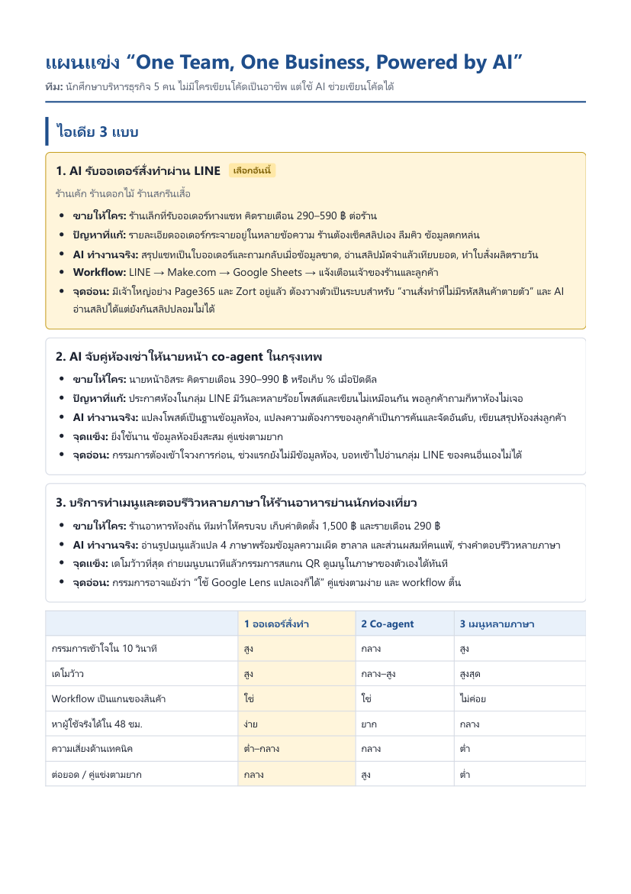
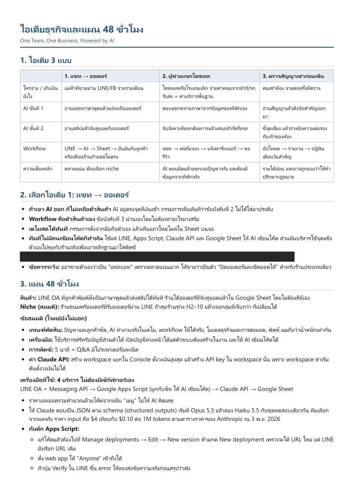
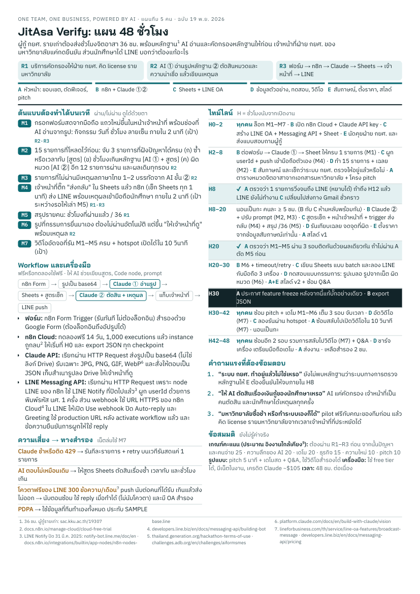

# manager-mode

A skill for Claude Code that runs big or risky tasks like a manager: agree on what "done" means before any work starts, split the work, check the result against that list, and report what was proven and what was not.

Work that comes back for fixes usually comes back for one of two reasons. The request was misread, or nobody checked the output before it was handed over. The skill puts its effort into those two points and keeps everything else light.

## What it changes

- The process fits the task. A question gets an answer. A small deliverable gets a short brief and a check. Only large or multi-part work is split across sessions.
- Work starts from a brief: the goal, the deliverable, and 3 to 7 checks that decide when it is done. Each check says how it will be proven: a command that fails when the work is broken, a review by someone who did not write it, or a look by you.
- Nothing changes until you ask for the work. Talking an idea through is not a go. Pushing, publishing and deleting each need their own go.
- Nothing is called done without evidence, and the evidence has to be newer than the last change. A number goes in only if it was read from a source or computed. Otherwise it says unknown.
- The final report is short and in your language: what was delivered, how each check was proven, and what is still unverified.

## Example: with and without the skill

Three plans for one hackathon, "One Team, One Business, Powered by AI": a team of five business students, 48 hours. Two were made without the skill and one with it. The plans are in Thai. Click a page to open the PDF.

| Without (run 1) | Without (run 2) | With manager mode |
|---|---|---|
| [](examples/hackathon-48h-plan/without-manager-mode-1.pdf) | [](examples/hackathon-48h-plan/without-manager-mode-2.pdf) | [](examples/hackathon-48h-plan/with-manager-mode.pdf) |

| | Without (run 1) | Without (run 2) | With manager mode |
|---|---|---|---|
| Idea chosen | LINE bot that turns order chats into orders and checks deposit slips, for made-to-order shops | LINE bot that turns order chats into orders and matches payment slips, for pre-order snack shops | JitAsa Verify: screens the 36 hours of volunteer work that student-loan borrowers must prove, so university staff only confirm |
| Other ideas in the plan | 2, compared in a table | 2, compared in a table | none |
| Length, not counting spaces | 3 pages, about 5,600 characters | 3 pages, about 5,700 characters | 1 dense page, about 4,600 characters |
| Sources | none | 2 prices, source named and dated, no link | 7 notes, 10 links |
| Stage demo checks (all three also plan a backup video) | 5 must-haves, not tied to the requirements one by one | M1 to M5, four of them tied to a competition requirement | M1 to M6, each tied to a requirement |
| Judging weights (all three call this an assumption) | 30/30/25/15, no basis given | equal | estimated from similar events, with sources |
| Who signs off each checkpoint | not named | not named | the team lead |
| Hard questions from judges | 2 points made elsewhere in the plan: competitors, fake slips | 1 point to raise before judges ask: fake slips | a section of 3 questions with answers; one answer is marked unconfirmed, with an owner and a deadline |

Both runs without the skill picked the same idea. Run 1 names the big players it has to work around, and run 2 calls the market crowded.

Two runs without the skill and one with it make an illustration, not a benchmark. All three PDFs were made on 19 November 2026. Nothing in them was fact-checked for this page, except that the 10 links in the third plan all opened on 22 November 2026. One line in run 2 that mentioned the requester's own projects is blacked out. Nothing else in the plans was changed.

## Install

As a Claude Code plugin:

```
claude plugin marketplace add neptunenakub/manager-mode
claude plugin install manager-mode@neptunenakub
```

Or copy `skills/manager-mode/SKILL.md` to `~/.claude/skills/manager-mode/SKILL.md`.

Claude uses the skill on multi-part or high-stakes work, or when you say "manager mode", "split this up", "use agents" or "check it properly".

## Where it runs

- Rooms, the sessions it starts under yours that you can open and steer, need the Claude desktop app in a local or SSH session. Elsewhere the skill gives the same orders to sub-agents in separate git worktrees.
- When plan mode is available, discussion happens there, where edits are blocked.
- Workflow mode runs only when you ask for a workflow or turn on ultracode.

## License

MIT. See [LICENSE](LICENSE).

## ภาษาไทย

manager-mode เป็น skill ของ Claude Code สำหรับงานใหญ่หรืองานที่พลาดแล้วเสียหาย ให้ Claude ทำงานแบบผู้จัดการ คือตกลงกันก่อนว่าแบบไหนถึงเรียกว่าเสร็จ แบ่งงาน ตรวจผลกับเกณฑ์นั้น แล้วรายงานว่าอะไรพิสูจน์แล้วและอะไรยังไม่ได้พิสูจน์

ตัวอย่างข้างบนเป็นแผนแข่งแฮ็กกาธอน 48 ชั่วโมงสามฉบับ สองฉบับทำโดยไม่ใช้ skill อีกฉบับใช้ ติดตั้งได้ด้วยสองคำสั่งในหัวข้อ Install
